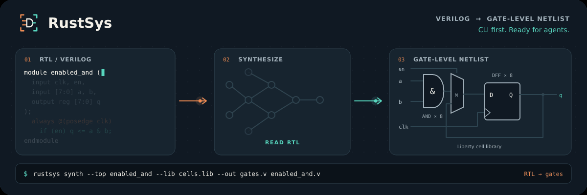

<p align="center">
  
</p>

<h1 align="center">Synthesis for the next design iteration.</h1>

<p align="center">
  <a href="https://lab-emi.github.io/RustEDA/modules/rustsys/">Documentation</a> ·
  <a href="https://github.com/lab-emi/RustEDA">RustEDA</a> ·
  <a href="https://lab-emi.github.io/RustEDA/benchmarks/">Benchmarks</a> ·
  <a href="LICENSE">Apache-2.0</a>
</p>

<picture>
  <source media="(prefers-reduced-motion: reduce)" srcset="docs/assets/rustsys-banner.svg">
  
</picture>

RustSys turns RTL into mapped netlists with bounded synthesis, technology mapping and independently checked equivalence.

Part of **[RustEDA](https://github.com/lab-emi/RustEDA)**, infrastructure for chip-design recursive self-improvement. Native tools shorten the work between inference steps; verified results guide the next iteration.

## Development status · 2026-10-28

The **RustEDA integration branch** combines bounded synthesis and mapping,
BLIF/AIGER/mapped-netlist inputs, revision-aware optimization and the shared
RustEDA foundation. The five-design, three-library benchmark retains arbitrary
initial state: all 30 tool/design/library netlists pass RTL equivalence.

Real-SRAM macro preservation is being developed for IHP Ibex in a separate
experimental checkout. It is not included in this integration snapshot and does
not establish physical closure. The standalone `main` branch can lag this
integration; use `codex/unified-brand` or RustEDA's pinned recursive checkout.

[Development status and evidence](docs/development-status.md) ·
[RustEDA engine progress](https://lab-emi.github.io/RustEDA/engine-status/)

## Benchmarks

**CPU: AMD Ryzen 9 9950X3D 16-Core Processor** · 16 physical host cores per tool, no SMT siblings.

Five complete RISC-V designs × three PDKs: Sky130 HD, GF180 7T, and
**EZ130 8T v1.1 on IHP SG13G2** (TT, 1.20 V, 25°C). **16 physical host cores per tool**,
one warm-up and three measured runs; median wall times below.
Time includes workspace init/import, synthesis, mmap and full Verilog export;
source preparation, LEC and timing analysis are outside the timer.

<!-- open-hardware-benchmark:start -->

| Design | PDK | RustSys<br>16 cores, s ↓ | Yosys<br>16 cores, s ↓ | RustSys<br>Speedup ↑ | RustSys<br>Peak mem, MiB ↓ | Yosys<br>Peak mem, MiB ↓ | RustSys<br>Area, µm² ↓ | Yosys<br>Area, µm² ↓ | RustSys<br>Setup Fmax†, MHz ↑ | Yosys<br>Setup Fmax†, MHz ↑ |
|---|---|---:|---:|---:|---:|---:|---:|---:|---:|---:|
| Ibex | Sky130 HD | 0.90 | 6.66 | **7.40×** | 92.1 | 273.1 | 117,405 | 123,670 | 42.92 | 33.47 |
| Ibex | GF180 7T | 1.00 | 6.69 | **6.69×** | 122.8 | 273.0 | 356,149 | 379,410 | 14.93 | 8.33 |
| Ibex | EZ130 8T | 0.79 | 6.80 | **8.61×** | 91.9 | 272.4 | 145,667 | 151,762 | 55.13 | 43.31 |
| PicoRV32 | Sky130 HD | 0.50 | 1.12 | **2.24×** | 67.4 | 81.0 | 76,169 | 83,603 | 107.53 | 67.75 |
| PicoRV32 | GF180 7T | 0.59 | 1.51 | **2.56×** | 117.4 | 100.2 | 233,097 | 255,798 | 26.65 | 15.98 |
| PicoRV32 | EZ130 8T | 0.44 | 1.46 | **3.32×** | 68.3 | 76.4 | 97,920 | 99,559 | 157.73 | 73.15 |
| SERV | Sky130 HD | 0.37 | 0.87 | **2.35×** | 65.8 | 71.9 | 51,461 | 54,067 | 60.28 | 57.47 |
| SERV | GF180 7T | 0.76 | 1.14 | **1.50×** | 117.4 | 90.4 | 163,404 | 167,428 | 43.27 | 19.54 |
| SERV | EZ130 8T | 0.31 | 1.10 | **3.55×** | 62.1 | 67.0 | 64,550 | 65,052 | 181.49 | 67.02 |
| VexRiscv | Sky130 HD | 2.47 | 63.53 | **25.72×** | 461.7 | 840.2 | 2,399,458 | 2,909,809 | 10.22 | 1.56 |
| VexRiscv | GF180 7T | 2.34 | 79.27 | **33.88×** | 496.0 | 864.1 | 7,490,709 | 8,856,262 | 4.47 | 0.689 |
| VexRiscv | EZ130 8T | 2.95 | 79.06 | **26.80×** | 879.8 | 853.5 | 3,225,087 | 3,429,484 | 4.20 | 2.12 |
| OpenC910 | Sky130 HD | 68.79 | 1,413.58 | **20.55×** | 7,702.1 | 16,339.8 | 53,453,688 | 59,995,158 | 0.69 | 0.0486 |
| OpenC910 | GF180 7T | 63.88 | 2,712.45 | **42.46×** | 7,731.3 | 17,511.3 | 165,273,357 | 184,901,294 | 0.0989 | 0.00397 |
| OpenC910 | EZ130 8T | 74.44 | 2,811.45 | **37.77×** | 8,559.3 | 16,979.2 | 71,069,802 | 72,190,882 | 0.0171 | 0.0159 |

<!-- open-hardware-benchmark:end -->

**Peak mem** = maximum GNU time process peak RSS across the three timed runs, in MiB.
Aggregate cgroup memory peaks remain in the complete receipts.

† **Setup-Fmax is an OpenSTA estimate** at the TT corner with ideal clocks and no wire
parasitics. SERV/EZ130 and OpenC910 loads exceed Liberty characterization limits;
these raw estimates do not establish achievable frequency. [Timing scope](https://lab-emi.github.io/RustEDA/modules/rustsys/guide/performance/#interpret-the-timing-estimate).

Speedup = **Yosys time ÷ RustSys time**. All **30 distinct netlists pass
arbitrary-state RTL LEC**, with no reset or input assumption added.

[Current runtime audit, three-PDK refresh and LEC](verification/benchmarks/open-hardware/results/2026-10-23-gf180-runtime-audit/README.md) ·
[Historical Sky130/GF180: full 1/16-core results and LEC certificates](verification/benchmarks/open-hardware/results/2026-10-21-default-multicore/README.md) ·
[IHP/EZ130: 16-core results and LEC certificates](verification/benchmarks/open-hardware/results/2026-10-23-ez130/README.md) ·
[Benchmark method](https://lab-emi.github.io/RustEDA/modules/rustsys/guide/benchmarks/).

SERV/EZ130 uses **0.77% less cell area than Yosys**, with **3.55×** faster synthesis.
The current runtime repair remeasures RustSys across all three PDKs and retains
the pinned Yosys runs. All fifteen RustSys netlists are unchanged from the area
fix; exact-byte LEC and timing reuse is explicit.
EZ130 functional LEC follows the vendor’s nominal tie-cell Verilog
models; the Liberty driver-type conflict and checked supplement are
[documented explicitly](https://lab-emi.github.io/RustEDA/modules/rustsys/verification/pdk/#additional-ihp-sg13g2-benchmark-library).

<!-- gf180-audit:start -->

**GF180 repeated before/current RustSys audit · 16 physical cores.**
Two excluded paired warm-ups; 40 A/B pairs for Ibex/PicoRV32/SERV, 64 for
VexRiscv and 12 for complete OpenC910. Eight same-binary control pairs per
smaller design, two for OpenC910. These use a high-resolution complete-CLI timer;
the RustSys/Yosys overview above keeps its separate three-run protocol.

| Design · GF180 7T | A/B pairs | Paired median Δ, ms | 99% interval, ms |
|---|---:|---:|---:|
| Ibex | 40 | -2.898 | [-9.946, +1.393] |
| PicoRV32 | 40 | -5.063 | [-9.458, -2.269] |
| SERV | 40 | -6.113 | [-12.138, -2.229] |
| VexRiscv | 64 | -0.463 | [-48.791, +37.252] |
| OpenC910 | 12 | -221.553 | [-1352.275, +880.824] |

Δ = current minus before; positive means slower. Δ is the median of paired differences. Before is the frozen
pre-SERV-area producer; current includes the runtime repair. No confirmed
regression was detected. Intervals crossing zero do not prove exact equality;
VexRiscv and OpenC910 cannot resolve a 0.01 s change at this confidence level.
All measured GF180 netlists match the checked implementation bytes; area and
raw setup-Fmax are unchanged. [All rounds, A/A controls, limits and 30 revalidated
arbitrary-state LEC certificates](verification/benchmarks/open-hardware/results/2026-10-23-gf180-runtime-audit/README.md).

<!-- gf180-audit:end -->

<!-- large-hardware-benchmark:start -->

<details>
<summary>Workload, proof and timing scope</summary>

### OpenC910 configuration and proof scope

The OpenC910 RTL top is `ct_core`: one complete processor core with default 64 KiB
instruction and 64 KiB data caches, lowered to standard cells. The 16 cores above
are **host CPU resources**, not a change to the hardware configuration. L2 and
other processor cores are outside this RTL top. The source/caches are unchanged.

OpenC910 uses the same one-warm-up/three-sample protocol as every other design.
The common Yosys flow preserves arbitrary initial state and uses default ABC
library mapping for all five designs. RustSys uses area/medium mapping with
its 4 GiB cut-storage budget, retaining the effective cut counts in every report.

All netlists use the independent RTL event model with
ordinary X/Z data and undriven wires completed to zero, plus external ABC CEC.
Inferred multiply/add blocks use exact arithmetic components checked by Arisca,
with complete ABC checks of their Boolean context, component/context
reconstruction, and transport to the actual measured netlist.
The same semantic contract applies to every tool/design pair. Every result
keeps arbitrary implementation initial state under checked correspondence;
**no reset sequence or input assumption is added**.

† OpenSTA 3.1.0 setup-Fmax estimate at each library's TT corner: ideal clocks,
100 ps input/clock slew, 10 fF output load, zero I/O delays and no wire parasitics.
MHz = 1000 / reported minimum period in ns, within the report's printed precision.
Same-clock, same-edge register paths only; port paths, cross-edge paths and
level-sensitive latch paths are excluded by `report_clock_min_period`.
Unclocked or otherwise unconstrained endpoints are outside this estimate;
constraint-check receipts are retained. OpenC910 exceeds the default cleanup budget. OpenC910/Sky130 critical-path loads exceed the Liberty characterization range (RustSys/Yosys: 49.60/55.98 pF; respective cell limits 0.052195/0.190440 pF). These raw estimates do not establish achievable or signoff Fmax.

</details>

<!-- large-hardware-benchmark:end -->

<!-- parallel-hardware-scaling:start -->

For Sky130/GF180, both tools emit byte-identical netlists at 1 and 16 cores;
thread count preserves measured area and timing. The linked baseline retains
the single-core comparisons and CPU scaling evidence. The IHP/EZ130 extension
measures 16 cores; it makes no new within-tool scaling claim.

<!-- parallel-hardware-scaling:end -->

## Quick start

Install [Rust with rustup](https://rustup.rs) and Git. The repository pins Rust 1.97.1.
The CPU flow needs no GPU or CUDA toolkit. Run these commands in one POSIX shell:

```sh
git clone --branch codex/unified-brand https://github.com/lab-emi/RustSys.git
cd RustSys
cargo install --locked --path crates/apps/rustsys-cli

FIX=verification/fixtures/synthetic/synth
mkdir -p .work
rustsys synth --top counter --lib "$FIX/lib/wt_rich.lib" \
  --out .work/counter_mapped.v --report .work/counter.json \
  "$FIX/rtl/counter/counter.sv"

rustsys check synth --top counter --lib "$FIX/lib/wt_rich.lib" \
  --netlist .work/counter_mapped.v "$FIX/rtl/counter/counter.sv"

rustsys show .work/counter.json --section cells --sort count --reverse --limit 5
```

The included synthetic counter maps to **45 cells**, with **8 retained state bits**.
The checker proves **9 output bits and 8 state pairs** equivalent. This uses a tiny demonstration
library; its area and delay are not PDK measurements.

Bring your own RTL with `--top`, repeatable `--lib`, `-I`, `-D`, and `-P`.
[Installation options](docs/guide/installation.md) · [Walkthrough](docs/guide/quickstart.md) ·
[Synthesis guide](docs/guide/synthesis.md).

## Built for CLI and agent workflows

### Synthesize → check → query

Record a run once, then reuse its exact inputs and options for checking:

```sh
export RUSTSYS_RUNS_ROOT="$PWD/.work/runs"
rustsys synth --top counter --lib "$FIX/lib/wt_rich.lib" --record \
  --print json "$FIX/rtl/counter/counter.sv" > .work/synthesis.json
rustsys check synth --from-run @synth --record --print json > .work/check.json
rustsys show @synth --section cells --print tsv > .work/cells.tsv
rustsys show @synth --section command
```

A recorded run stores the canonical command, input hashes, netlist, reports, and `events.jsonl`.
`@synth` selects the latest synthesis run under that runs root; use an explicit run directory
when independent jobs share a root. `--print json` emits the direct command's report.

### Read → change → commit

For work that spans tools or multiple steps, install the shared workspace CLI too:

```sh
cargo install --locked --path crates/apps/rusteda-cli

WS=.work/counter-workspace
rusteda -w "$WS" --format json init
rusteda -w "$WS" --format json import --base-rev rev0 \
  --lib "$FIX/lib/wt_rich.lib" --rtl "$FIX/rtl/counter/counter.sv" --top counter
rustsys -w "$WS" --format json synth --base-rev rev1 --check
rusteda -w "$WS" --format json export --rev rev2 --netlist .work/counter_exported.v
```

Use a fresh workspace directory for this example. Workspace commands return one **`rusteda.v1`
JSON envelope** with status, diagnostics, artifacts, and suggested next actions. Every mutation
of an existing workspace names the expected revision; a stale base fails with
`REVISION_CONFLICT` (exit 4). Commands acquire disk locks, finish, and exit.

| Contract | What a script or agent can rely on |
|---|---|
| Machine output | Direct file mode: `--print json`; workspace mode: `--format json`. These have different schemas. |
| Diagnostics | Stable message codes, locations when available, and progress on stderr. |
| Queryable results | `show` filters, sorts, and selects sections; exports text, JSON, or TSV. |
| Reproducibility | Canonical commands and input hashes in recorded runs; deterministic netlists across thread counts and mapping backends. |
| Explicit outcomes | 0 success; 1 rejected input; 2 internal failure; 3 inequivalent; 4 revision conflict in workspace mode; 5 proof undecided. |
| Bounded work | Proof/search budgets report exhaustion as undecided; `unverified` evidence stays unverified. |

[Agent integration recipes](docs/guide/agents.md) · [CLI reference](docs/reference/cli.md) ·
[JSON and report contracts](docs/reference/reports.md) · [Agent documentation index](https://lab-emi.github.io/RustEDA/modules/rustsys/llms.txt).

## Synthesis and verification

- **SystemVerilog front end:** packages, parameters, packed structures, arrays, generate blocks,
  functions, tasks, registers, and latches. BLIF, AIGER, and mapped-netlist inputs are also supported.
- **Standard-cell mapping:** AIG optimization and Boolean matching to your Liberty libraries,
  area or delay goals, three effort levels, and cell exclusion filters.
- **Timing refinement:** optional buffering, cell sizing, and electrical-limit repair using Liberty
  NLDM tables. Timing estimates assume ideal clocks and no interconnect.
- **CPU first, optional CUDA:** CPU synthesis needs no GPU dependencies at run time. CUDA
  accelerates mapping cut passes; a requested unavailable backend returns an error. Metal is planned.
- **Independent checking:** `rustsys check synth` interprets RTL, evaluates library cells, and
  proves output and state-transition obligations with its own checker and SAT implementation.
  It shares format readers and core tables with synthesis; external LEC provides another oracle.

By default, retained register and latch initial states remain arbitrary; state is not merged,
retimed, or re-encoded. Reset assumptions and initial-state refinement are explicit opt-ins and
change the proof scope. The benchmark proofs above add no reset sequence.

The synthesis semantics are two-valued: ordinary `x`/`z` data bits become zero, while language
wildcards retain their matching semantics. Unsupported constructs are diagnosed. Interfaces,
modports, tri-state logic, `inout`, and dynamic types are among the current limitations.

[Language and library support](docs/reference/language-support.md) ·
[Checking and proof scopes](docs/guide/checking.md) ·
[GPU and timing guide](docs/guide/gpu-and-timing.md) · [Troubleshooting](docs/guide/troubleshooting.md).

## Documentation

The [documentation site](https://lab-emi.github.io/RustEDA/modules/rustsys/) follows a task-based path from a first netlist to repeatable automation
and inspectable proof evidence. All pages also live in this repository.

| Start here | Go deeper |
|---|---|
| [Documentation home](https://lab-emi.github.io/RustEDA/modules/rustsys/) | [Architecture and crate boundaries](docs/architecture/index.md) |
| [Install and run your first design](docs/guide/quickstart.md) | [Synthesis specifications](docs/specs/synth/README.md) |
| [Automate with scripts and agents](docs/guide/agents.md) | [Workspace and JSON protocol](docs/specs/workspace/README.md) |
| [Check equivalence](docs/guide/checking.md) | [Verification evidence and limitations](docs/verification/index.md) |
| [Understand the benchmarks](docs/guide/benchmarks.md) | [Architecture decisions](docs/adr/) |

Build the site locally (documentation-only dependencies):

```sh
python3 -m venv .work/docs-venv
.work/docs-venv/bin/pip install -r docs/requirements.txt
.work/docs-venv/bin/mkdocs build --strict -f docs/mkdocs.yml
```

See [documentation maintenance](docs/about/maintaining-docs.md) for previewing, checking links,
and publishing through the included GitHub Pages workflow. The [brand guide](docs/brand/README.md)
explains the RustEDA family marks and how to regenerate the animation.

## Development and contributing

RustSys is clean-room Rust. Reference tools interoperate as external executables over standard
formats. Engine and checker crates remain independent; `cargo xtask layout` enforces crate boundaries.

[Contributor guide](docs/contributing.md) · [Repository rules](CONTRIBUTING.md) ·
[Requirement coverage](docs/verification/requirements.md) · [Changelog](CHANGELOG.md).
The contributor guide lists the required formatting, lint, verification, and memory-bounded checks.
Report vulnerabilities using [SECURITY.md](SECURITY.md); participants follow the
[code of conduct](CODE_OF_CONDUCT.md).

Licensed under [Apache-2.0](LICENSE). See [NOTICE](NOTICE).
