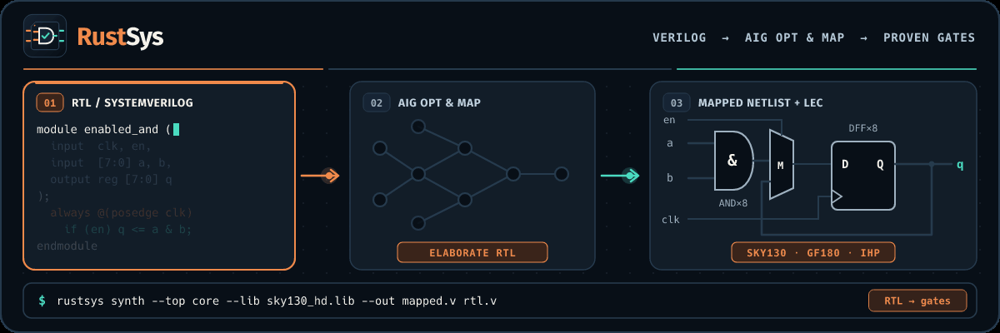

<p align="center">
  
</p>

<p align="center">
  <strong>Clean-room RTL synthesis, technology mapping, and formal equivalence checking in Rust.</strong><br>
  <a href="https://lab-emi.github.io/RustEDA/modules/rustsys/">Documentation</a> ·
  <a href="https://github.com/lab-emi/RustEDA">RustEDA Suite</a> ·
  <a href="https://lab-emi.github.io/RustEDA/benchmarks/">Benchmarks</a> ·
  <a href="docs/development-status.md">Development Status</a> ·
  <a href="LICENSE">Apache-2.0</a>
</p>

<picture>
  <source media="(prefers-reduced-motion: reduce)" srcset="docs/assets/rustsys-banner.svg">
  
</picture>

## Why RustSys

RustSys replaces multi-minute legacy synthesis scripts with deterministic, bounded Rust synthesis that pairs **33–47× faster mapping** with **formal combinational and reset-reachable equivalence proofs** across SKY130, GF180MCU, and IHP SG13G2.

| Benchmark (same prepared inputs, receipt-backed) | RustSys | Reference (`Yosys + ABC`) | RustSys delta |
| --- | ---: | ---: | --- |
| **Ibex + 2 SRAMs** (IHP SG13G2 / EZ130, 3-run median) | **3.07 s** (2.19 s direct) | 103.91 s | **33.8× faster** (47.4× direct) |
| **Peak memory** (same Ibex synthesis) | **113.5 MiB** | 747.7 MiB | **6.6× less RAM** |
| **Post-synth QoR** (Ibex stdcell area / logic depth) | **145,227 µm² / 36** | 147,867 µm² / 40 | **-1.8% area, -4 levels** |
| **Multi-design full flows** (`picorv32`, `aes_core`, `sha256_core`) | **8/8 signoff PASS** | LibreLane 3.0.17 | **+18.7% to +70.4% SS Fmax** |
| **Equivalence checking** (synthesis & final netlist) | **ABC CEC proven** | Unverified (433 renamed FFs) | **Proved arbitrary-init + FSM map** |

Detailed receipts and host deviations live in [RustEDA Benchmarks](https://lab-emi.github.io/RustEDA/benchmarks/) (`ibex-sg13g2-ez130-host-20261113.json`, `multi-design/results.json`).

## Core Capabilities

- **Daemonless disk workspaces**: Operates directly on `--workspace <dir>` with `workspace.lock`, `--base-rev` optimistic concurrency (`REVISION_CONFLICT`), shell-safe handles (`rev1`, `inst42`), and structured `rusteda.v1` JSON output.
- **Bounded AIG optimization & Liberty mapping**: Explicit `max_cuts`, `max_expansions`, and memory budgets prevent combinatorial blowups on reconvergent datapaths; supports opaque hard macros (`SRAM`), `--aligned-selects`, and dual/tri-PDK NLDM Liberty tables (`sky130_fd_sc_hd`, `gf180mcu_fd_sc_mcu7t5v0` / `9t5v0`, `ihp-sg13g2`).
- **Independent formal LEC + FSM state correspondence**: Exports bit-exact AIGER miters for black-box ABC CEC (`arbitrary_initial` one-to-one state proof) and discovers reset-reachable re-encoded FSM state maps with proved valid-code invariants (`verify_state_map`).
- **Explicit diagnostics**: Never silently drops unsupported Verilog/SystemVerilog constructs, Liberty tables, or SDC constraints.

## Quick Start

```sh
# Build the CLI (or via superproject: ./dev build RustSys --release)
cargo build --release -p rustsys-cli

# Direct RTL-to-gates synthesis
target/release/rustsys synth \
  --top enabled_and \
  --lib path/to/sky130_fd_sc_hd__tt_025C_1v80.lib \
  --out mapped.v \
  rtl/enabled_and.v

# Workspace mode with revision guard + JSON output
target/release/rustsys -w ./ws --format json synth --base-rev rev1 --top core
```

See [Quickstart](docs/guide/quickstart.md), [CLI Reference](docs/reference/cli.md), and [Checking & LEC](docs/guide/checking.md).

## Scope & Current Limits

- **Timing-driven synthesis across macros**: `rustsys synth --timing-period` and `opt-timing` currently reject designs containing opaque macro buses; tight-clock macro flows rely on structural mapping + downstream physical ECOs.
- **Bounded solver budgets**: Native SAT/CEC and external ABC proofs enforce explicit conflict/time budgets; budget exhaustion reports `unverified`, never a pass.
- **Historical records**: Archived Ibex host campaigns and the withdrawn full-SoC PULPissimo synthesis archive are preserved in [Development Status](docs/development-status.md) and [RustEDA Benchmarks](https://lab-emi.github.io/RustEDA/benchmarks/).

## License

Apache-2.0 — see [LICENSE](LICENSE).
