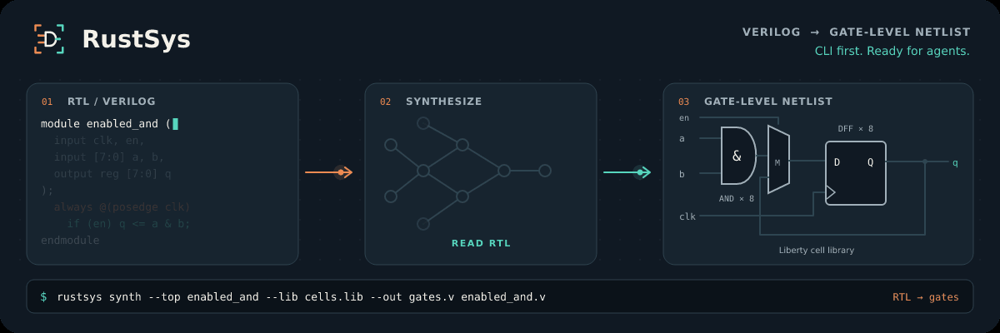

<p align="center">
  
</p>

<h1 align="center">Synthesis for the next design iteration.</h1>

<p align="center">
  <a href="https://lab-emi.github.io/RustEDA/modules/rustsys/">Documentation</a> ·
  <a href="https://github.com/lab-emi/RustEDA">RustEDA</a> ·
  <a href="https://lab-emi.github.io/RustEDA/benchmarks/">Benchmarks</a> ·
  <a href="LICENSE">Apache-2.0</a>
</p>

<picture>
  <source media="(prefers-reduced-motion: reduce)" srcset="docs/assets/rustsys-banner.svg">
  
</picture>

RustSys turns RTL into mapped netlists with bounded synthesis, technology mapping and independently checked equivalence.

Part of **[RustEDA](https://github.com/lab-emi/RustEDA)**, infrastructure for chip-design recursive self-improvement. Native tools shorten the work between inference steps; verified results guide the next iteration.

## Development status · 2026-10-28

The **RustEDA integration branch** combines bounded synthesis and mapping,
BLIF/AIGER/mapped-netlist inputs, revision-aware optimization and the shared
RustEDA foundation. The earlier Ibex three-library synthesis campaign retains
arbitrary initial state: all six tool/library netlists pass RTL equivalence.

Real-SRAM macro preservation is being developed for IHP Ibex in a separate
experimental checkout. It is not included in this integration snapshot and does
not establish physical closure. The standalone `main` branch can lag this
integration; use `codex/unified-brand` or RustEDA's pinned recursive checkout.

[Development status and evidence](docs/development-status.md) ·
[RustEDA engine progress](https://lab-emi.github.io/RustEDA/engine-status/)

## Benchmarks

The published benchmark is the Ibex RV32 core with two real IHP SRAMs on IHP
SG13G2 with the ETH EZ130 8T library, run end to end through the native RustEDA
flow and compared with LibreLane. RustSys synthesizes the Ibex + SRAM design in
that flow; the flow's synthesis and final CEC gates prove the synthesized and
final netlists equivalent to the original RTL. The SRAM macro preservation that
this run needs is the separate development noted above: run16 used the separately
qualified RustSys binary `e6cf0c77…` built from it, not this snapshot.

[RustEDA benchmarks](https://lab-emi.github.io/RustEDA/benchmarks/) ·
[RustSys in the whole-flow benchmark](https://lab-emi.github.io/RustEDA/modules/rustsys/guide/benchmarks/)

## Quick start

Install [Rust with rustup](https://rustup.rs) and Git. The repository pins Rust 1.97.1.
The CPU flow needs no GPU or CUDA toolkit. Run these commands in one POSIX shell:

```sh
git clone --branch codex/unified-brand https://github.com/lab-emi/RustSys.git
cd RustSys
cargo install --locked --path crates/apps/rustsys-cli

FIX=verification/fixtures/synthetic/synth
mkdir -p .work
rustsys synth --top counter --lib "$FIX/lib/wt_rich.lib" \
  --out .work/counter_mapped.v --report .work/counter.json \
  "$FIX/rtl/counter/counter.sv"

rustsys check synth --top counter --lib "$FIX/lib/wt_rich.lib" \
  --netlist .work/counter_mapped.v "$FIX/rtl/counter/counter.sv"

rustsys show .work/counter.json --section cells --sort count --reverse --limit 5
```

The included synthetic counter maps to **45 cells**, with **8 retained state bits**.
The checker proves **9 output bits and 8 state pairs** equivalent. This uses a tiny demonstration
library; its area and delay are not PDK measurements.

Bring your own RTL with `--top`, repeatable `--lib`, `-I`, `-D`, and `-P`.
[Installation options](docs/guide/installation.md) · [Walkthrough](docs/guide/quickstart.md) ·
[Synthesis guide](docs/guide/synthesis.md).

## Built for CLI and agent workflows

### Synthesize → check → query

Record a run once, then reuse its exact inputs and options for checking:

```sh
export RUSTSYS_RUNS_ROOT="$PWD/.work/runs"
rustsys synth --top counter --lib "$FIX/lib/wt_rich.lib" --record \
  --print json "$FIX/rtl/counter/counter.sv" > .work/synthesis.json
rustsys check synth --from-run @synth --record --print json > .work/check.json
rustsys show @synth --section cells --print tsv > .work/cells.tsv
rustsys show @synth --section command
```

A recorded run stores the canonical command, input hashes, netlist, reports, and `events.jsonl`.
`@synth` selects the latest synthesis run under that runs root; use an explicit run directory
when independent jobs share a root. `--print json` emits the direct command's report.

### Read → change → commit

For work that spans tools or multiple steps, install the shared workspace CLI too:

```sh
cargo install --locked --path crates/apps/rusteda-cli

WS=.work/counter-workspace
rusteda -w "$WS" --format json init
rusteda -w "$WS" --format json import --base-rev rev0 \
  --lib "$FIX/lib/wt_rich.lib" --rtl "$FIX/rtl/counter/counter.sv" --top counter
rustsys -w "$WS" --format json synth --base-rev rev1 --check
rusteda -w "$WS" --format json export --rev rev2 --netlist .work/counter_exported.v
```

Use a fresh workspace directory for this example. Workspace commands return one **`rusteda.v1`
JSON envelope** with status, diagnostics, artifacts, and suggested next actions. Every mutation
of an existing workspace names the expected revision; a stale base fails with
`REVISION_CONFLICT` (exit 4). Commands acquire disk locks, finish, and exit.

| Contract | What a script or agent can rely on |
|---|---|
| Machine output | Direct file mode: `--print json`; workspace mode: `--format json`. These have different schemas. |
| Diagnostics | Stable message codes, locations when available, and progress on stderr. |
| Queryable results | `show` filters, sorts, and selects sections; exports text, JSON, or TSV. |
| Reproducibility | Canonical commands and input hashes in recorded runs; deterministic netlists across thread counts and mapping backends. |
| Explicit outcomes | 0 success; 1 rejected input; 2 internal failure; 3 inequivalent; 4 revision conflict in workspace mode; 5 proof undecided. |
| Bounded work | Proof/search budgets report exhaustion as undecided; `unverified` evidence stays unverified. |

[Agent integration recipes](docs/guide/agents.md) · [CLI reference](docs/reference/cli.md) ·
[JSON and report contracts](docs/reference/reports.md) · [Agent documentation index](https://lab-emi.github.io/RustEDA/modules/rustsys/llms.txt).

## Synthesis and verification

- **SystemVerilog front end:** packages, parameters, packed structures, arrays, generate blocks,
  functions, tasks, registers, and latches. BLIF, AIGER, and mapped-netlist inputs are also supported.
- **Standard-cell mapping:** AIG optimization and Boolean matching to your Liberty libraries,
  area or delay goals, three effort levels, and cell exclusion filters.
- **Timing refinement:** optional buffering, cell sizing, and electrical-limit repair using Liberty
  NLDM tables. Timing estimates assume ideal clocks and no interconnect.
- **CPU first, optional CUDA:** CPU synthesis needs no GPU dependencies at run time. CUDA
  accelerates mapping cut passes; a requested unavailable backend returns an error. Metal is planned.
- **Independent checking:** `rustsys check synth` interprets RTL, evaluates library cells, and
  proves output and state-transition obligations with its own checker and SAT implementation.
  It shares format readers and core tables with synthesis; external LEC provides another oracle.

By default, retained register and latch initial states remain arbitrary; state is not merged,
retimed, or re-encoded. Reset assumptions and initial-state refinement are explicit opt-ins and
change the proof scope.

The synthesis semantics are two-valued: ordinary `x`/`z` data bits become zero, while language
wildcards retain their matching semantics. Unsupported constructs are diagnosed. Interfaces,
modports, tri-state logic, `inout`, and dynamic types are among the current limitations.

[Language and library support](docs/reference/language-support.md) ·
[Checking and proof scopes](docs/guide/checking.md) ·
[GPU and timing guide](docs/guide/gpu-and-timing.md) · [Troubleshooting](docs/guide/troubleshooting.md).

## Documentation

The [documentation site](https://lab-emi.github.io/RustEDA/modules/rustsys/) follows a task-based path from a first netlist to repeatable automation
and inspectable proof evidence. All pages also live in this repository.

| Start here | Go deeper |
|---|---|
| [Documentation home](https://lab-emi.github.io/RustEDA/modules/rustsys/) | [Architecture and crate boundaries](docs/architecture/index.md) |
| [Install and run your first design](docs/guide/quickstart.md) | [Synthesis specifications](docs/specs/synth/README.md) |
| [Automate with scripts and agents](docs/guide/agents.md) | [Workspace and JSON protocol](docs/specs/workspace/README.md) |
| [Check equivalence](docs/guide/checking.md) | [Verification evidence and limitations](docs/verification/index.md) |
| [Understand the benchmarks](docs/guide/benchmarks.md) | [Architecture decisions](docs/adr/) |

Build the site locally (documentation-only dependencies):

```sh
python3 -m venv .work/docs-venv
.work/docs-venv/bin/pip install -r docs/requirements.txt
.work/docs-venv/bin/mkdocs build --strict -f docs/mkdocs.yml
```

See [documentation maintenance](docs/about/maintaining-docs.md) for previewing, checking links,
and publishing through the included GitHub Pages workflow. The [brand guide](docs/brand/README.md)
explains the RustEDA family marks and how to regenerate the animation.

## Development and contributing

RustSys is clean-room Rust. Reference tools interoperate as external executables over standard
formats. Engine and checker crates remain independent; `cargo xtask layout` enforces crate boundaries.

[Contributor guide](docs/contributing.md) · [Repository rules](CONTRIBUTING.md) ·
[Requirement coverage](docs/verification/requirements.md) · [Changelog](CHANGELOG.md).
The contributor guide lists the required formatting, lint, verification, and memory-bounded checks.
Report vulnerabilities using [SECURITY.md](SECURITY.md); participants follow the
[code of conduct](CODE_OF_CONDUCT.md).

Licensed under [Apache-2.0](LICENSE). See [NOTICE](NOTICE).
