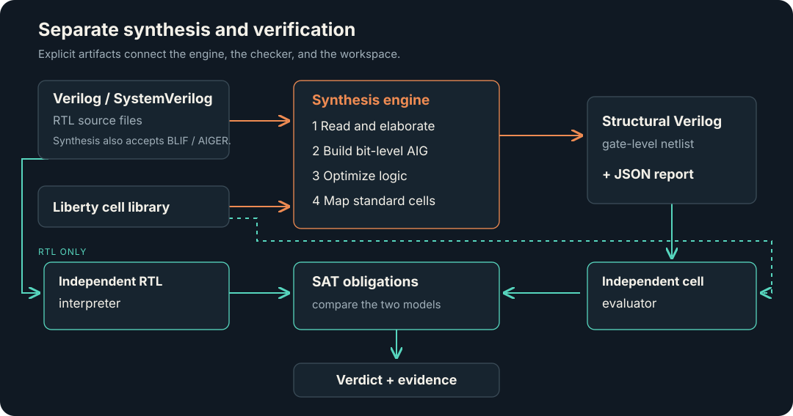

# Architecture

RustSys separates synthesis, verification, formats and storage so that each has a clear contract. The command-line layer connects those pieces without a resident service.

Synthesis reads and elaborates its input, builds a bit-level AIG, optimizes it,
and maps it to standard cells. The native RTL-to-netlist checker builds separate
RTL and cell models before solving equivalence obligations. Other supported
source formats use dedicated BLIF, AIGER, or gate-netlist models in the checker.
See the [checking guide](../guide/checking.md) for the supported proof scope and
incomplete outcomes.

## Crate boundaries

| Layer | Crate | Responsibility |
|---|---|---|
| Applications | `rustsys-cli` | `rustsys` commands, jobs, recorded runs, report rendering and workspace engine integration. |
| Applications | `rusteda-cli` | Generic workspace initialization, import, queries, diffs, revision movement and export. |
| Engine | `rustsys` | Elaboration, logic optimization, mapping, netlist emission and optional electrical refinement. |
| Verification | `rustsys-check` | Independent RTL/cell models and proof flow; no synthesis-engine dependency. |
| Formats | `rusteda-formats` | SystemVerilog/structural Verilog, Liberty, SDC, BLIF and AIGER readers. |
| Core | `rusteda-core` | Diagnostics, symbols, typed identities, library and gate-level models. |
| Core | `rusteda-workspace` | Locked disk workspaces, immutable revisions, cached libraries and binary side tables. |
| Compute | `rusteda-compute` | Deterministic CPU reference tasks and optional native GPU mapping/timing tasks. |
| Verification tools | `rustsys-fixtures`, `rustsys-defects` | Synthetic inputs and deliberate faults for checker validation. |
| Repository automation | `xtask` | Layout rules, shared-file integrity, requirement coverage and verification suites. |

Dependencies flow from applications toward engine/verification, formats and core. Engine and verification crates never depend on one another. `cargo xtask layout` enforces that direction. Shared readers mean the native checker is not a completely independent front end; external evidence and independently specified fixtures address common-error risks.

## Representations have distinct jobs

Mutable design models use typed arena identities and per-database string interning. Synthesis AIGs, gate-level netlists and compute views remain separate representations. Dense compute views use contiguous structures of arrays or CSR-style buffers where appropriate; they do not force every design stage into one graph type.

Graph traversal, mapping-cut storage and proof searches have explicit work/memory bounds. The mapper records effective cut counts when memory limits narrow its search. Checkers return incomplete outcomes when budgets are reached. Algorithms must not materialize unbounded sets of paths or cones on reconvergent graphs.

## Disk workspaces and revisions

A workspace stores a manifest, immutable revision directories, shared library cache, `workspace.lock` and append-only command history. Tables record hashes and upstream dependencies; changing an input invalidates derived tables whose dependencies no longer match. Committed binary tables are read through validated memory maps.

Readers take shared locks. A mutation computes from a concrete base revision and rechecks HEAD before committing under the exclusive lock. A stale base fails with `REVISION_CONFLICT`, giving concurrent agents a visible coordination boundary. See the [workspace contract](../specs/workspace/README.md) and [agent example](../guide/agents.md#workspaces-for-concurrent-agents).

## CPU and native acceleration

The deterministic pure-Rust CPU backend defines the reference computation. Native CUDA can accelerate mapping cut passes; exact area-recovery work stays on the CPU. Metal is planned. A requested unavailable backend fails explicitly, and GPU results require differential checks against the CPU reference.

See [compute specifications](../specs/compute/README.md), [synthesis specifications](../specs/synth/README.md), and [architecture decisions](../adr/0004-rusteda-crate-map-and-shared-crates.md).
