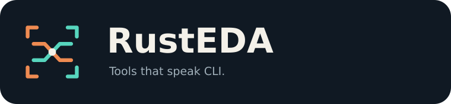

<!-- SPDX-License-Identifier: Apache-2.0 -->
<!-- SPDX-FileCopyrightText: 2026 RustSys contributors -->

# RustEDA visual identity

**Signal forge** is the shared visual theme for the RustEDA tool family: a command
enters, a signal changes form, and a concrete engineering artifact comes out.
The identity connects terminal workflows with electronic design rather than
using a mascot or a generic gear.



## The family mark

The four open corners suggest both a terminal frame and an integrated-circuit
package. Copper marks the input; teal marks the transformed output. The center
glyph identifies the tool without changing the outer frame, proportions, or
palette.

| Tool | Center glyph | Meaning |
| --- | --- | --- |
| RustEDA | Crossing signals and a shared node | Tools connected by explicit design artifacts |
| RustSys | Two inputs, a logic gate, one output | RTL becomes a standard-cell netlist |

Future family marks should change only the center glyph: a clock edge or timing
path for RustSTA, an array for compute, or a viewport for the studio. These are
extension rules for the identity, not a claim that those marks or features have
already shipped.


## Color and typography

| Role | Color | Use |
| --- | --- | --- |
| Ink | `#101923` | Mark and banner backgrounds |
| Copper | `#EF8B52` | Source code, input signals, small accents |
| Teal | `#57D6BE` | Output signals, active paths, links |
| Warm paper | `#F4F1E9` | Primary text and the gate outline |
| Muted text | `#A1B0BA` | Secondary labels |
| Panel | `#17242F` | Diagram cards |

The artwork uses DejaVu Sans and DejaVu Sans Mono with standard sans-serif and
monospace fallbacks. SVG text remains selectable and editable; fonts are not
embedded. The GIF rasterizes those fonts. Keep the mark's dark tile so it stays
legible on both light and dark pages, and leave at least one-quarter of the
center glyph's width clear around the tile. Use the square mark at small sizes;
reserve the wordmark for headings. Keep both signal colors when space allows.

## Verilog-to-gates animation

The banner follows a short, looping story:

1. A clock-enabled eight-bit Verilog AND register appears in a source pane.
2. Pulses move into a synthesis graph; two peripheral branches fade during
   optimization.
3. AND gates feed a feedback multiplexer and eight flip-flops. The enable drives
   the multiplexer select; the clock drives the flip-flops.
4. A clock pulse and output pulse travel through the circuit before the loop
   begins again.

The schematic matches the source operation and illustrates what synthesis does;
it is not a capture of a tool run or an equivalence result. Real library cell
choices and packing depend on the target library and mapping settings.
The visible shell command uses the supported `rustsys synth` interface. Benchmark
and proof claims belong in the linked reports, never inside the animation.


The static poster carries the complete story without motion. On the documentation
site, render it by default and select the GIF only when the user allows motion:

```html
<picture>
  <source media="(prefers-reduced-motion: no-preference)"
          srcset="../assets/rustsys-banner.gif" type="image/gif">
  
</picture>
```

Use paths relative to the embedding page. All SVGs have accessible titles and
descriptions. The animation uses smooth signal pulses, no flashes, and a
deliberate 8.4-second loop. The static image remains the reduced-motion and
unsupported-format fallback.

## Asset inventory

| Asset | Dimensions | Purpose |
| --- | --- | --- |
| [`rusteda-logo.svg`](../assets/rusteda-logo.svg) | 256 × 256 | Family mark |
| [`rusteda-wordmark.svg`](../assets/rusteda-wordmark.svg) | 760 × 176 | Family identity |
| [`rustsys-logo.svg`](../assets/rustsys-logo.svg) | 256 × 256 | RustSys mark |
| [`rustsys-wordmark.svg`](../assets/rustsys-wordmark.svg) | 760 × 176 | README and documentation headers |
| [`favicon.svg`](../assets/favicon.svg) | 256 × 256 | Site icon |
| [`rustsys-banner.svg`](../assets/rustsys-banner.svg) | 1200 × 400 | Static, accessible pipeline illustration |
| [`rustsys-banner.gif`](../assets/rustsys-banner.gif) | 1200 × 400 | 84 frames, 10 fps, 8.4-second loop |

## Source and reproduction

The artwork is original native SVG geometry, text, and animation code, distributed
under this repository's Apache-2.0 license. There is no external artwork,
reference-tool implementation, copied logo, or AI-generated raster asset. Original
vector geometry renders the static poster and all animated frames.

From the repository root:

```sh
free -h
python3 -m venv .work/brand-venv
.work/brand-venv/bin/python -m pip install -r docs/brand/requirements.txt
mkdir -p .work/brand
(
  ulimit -v 1048576
  /usr/bin/time -v -o .work/brand/render.time \
    timeout 180s .work/brand-venv/bin/python docs/_tools/generate_brand.py
)
```

The renderer is a documentation authoring tool. Python, Pillow, and CairoSVG are
not RustSys runtime dependencies. Only pre-rendered assets are needed to build the
documentation site. Install DejaVu fonts for matching text layout; rendered
results can differ across font, Cairo, and dependency versions.

The generator caps canvas size at 480,000 pixels, frame count at 96, and GIF size
at 1 MiB. Its working estimate is below 256 MiB: 84 indexed frames use about
38.5 MiB, with one RGB raster and Cairo/quantization scratch allocated at a time.
The measured render used less than **180 MiB peak RSS** and took about **4 seconds**;
the GIF is about **140 KiB**. The command above applies a 1 GiB virtual-memory
guard and a 180-second wall-clock guard. These are asset-rendering measurements,
not synthesis performance numbers.

The renderer also saves a four-frame contact sheet, poster preview, and SHA-256
manifest under `.work/brand/`. Those files are local QA artifacts; the distributed
assets live in `docs/assets/`. To refresh only SVGs without the renderer workload,
pass `--static-only`.
