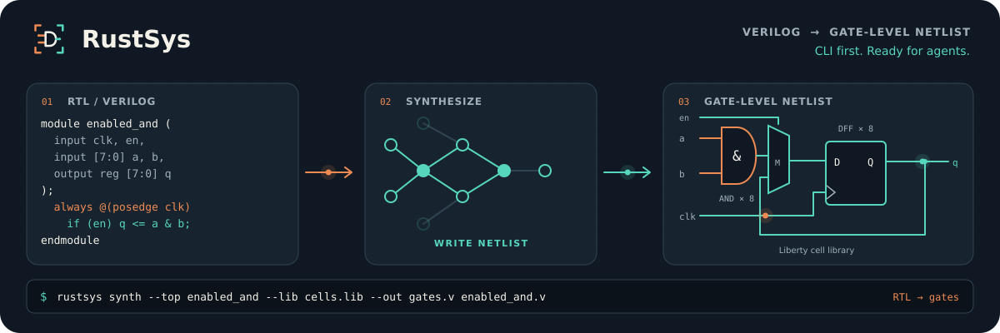

<!-- SPDX-License-Identifier: Apache-2.0 -->
<!-- SPDX-FileCopyrightText: 2026 RustSys contributors -->

<div class="rustsys-hero" markdown>

<p class="rustsys-eyebrow">RUSTEDA / LOGIC SYNTHESIS</p>

# From RTL to gates.<br>Built for the terminal.

RustSys turns Verilog and SystemVerilog into a standard-cell netlist.
Give your scripts and agents explicit inputs, inspectable JSON results,
recorded runs, and an equivalence check they can act on.

[Run your first synthesis](guide/quickstart.md){ .md-button .md-button--primary }
[Build an agent workflow](guide/agents.md){ .md-button }

<p class="rustsys-release">Source preview · 0.1.0 · Apache-2.0 · CPU reference backend</p>

</div>

<figure class="rustsys-banner">
  <picture>
    <source media="(prefers-reduced-motion: no-preference)" srcset="assets/rustsys-banner.gif" type="image/gif">
    
  </picture>
  <figcaption>An illustration of RTL → synthesis → standard cells. <button type="button" class="rustsys-motion-control" aria-pressed="false" hidden>Pause animation</button></figcaption>
</figure>

## A CLI you can compose

<div class="grid cards" markdown>

- **Start with files. Finish with files.**

    ---

    Read RTL and Liberty. Export gate-level Verilog and a JSON report.
    Run in a shell, a CI job, or an agent loop.

    [Synthesis workflow →](guide/synthesis.md)

- **Give agents a contract.**

    ---

    Keep results on standard output and diagnostics on standard error.
    Use structured errors, bounded tables, revision guards, and explicit exit statuses.

    [Agent integration →](guide/agents.md)

- **Keep the evidence.**

    ---

    Record resolved commands, input hashes, events, and reports.
    Check the exported netlist with a separate RTL interpreter and SAT solver.

    [Equivalence workflow →](guide/checking.md)

- **Inspect the comparison.**

    ---

    Compare RustSys and Yosys on Ibex, PicoRV32, SERV, VexRiscv, and OpenC910.
    Every result states its workload, library, measurement method, and proof scope.

    [Benchmarks and proof status →](guide/benchmarks.md)

</div>

## Choose your path

| I want to… | Start here |
|---|---|
| Install the CLI and try a small checked design | [Installation](guide/installation.md) → [quickstart](guide/quickstart.md) |
| Synthesize my own RTL against a cell library | [Synthesis](guide/synthesis.md) → [language support](reference/language-support.md) |
| Drive the tools from an agent or CI system | [Agent workflow](guide/agents.md) → [commands](reference/cli.md) → [reports](reference/reports.md) |
| Understand what a proof establishes | [Equivalence checking](guide/checking.md) → [verification scope](verification/index.md) |
| Reproduce a comparison or assess a performance claim | [Benchmarks](guide/benchmarks.md) |
| Scale CPU synthesis and compare area or setup-Fmax | [CPU performance and scaling](guide/performance.md) |
| Extend RustSys or another RustEDA tool | [Architecture](architecture/index.md) → [contributing](contributing.md) |

## A small first run

From the repository root, after [building RustSys](guide/installation.md):

```bash
FIX=verification/fixtures/synthetic/synth
rustsys synth --top counter --lib "$FIX/lib/wt_rich.lib" \
  --out .work/counter_mapped.v --report .work/counter.json \
  "$FIX/rtl/counter/counter.sv"

rustsys check synth --top counter --lib "$FIX/lib/wt_rich.lib" \
  --netlist .work/counter_mapped.v "$FIX/rtl/counter/counter.sv"
```

The bundled library is a small verification fixture. Use a characterized
technology library for your own standard-cell targets. The
[quickstart](guide/quickstart.md) explains the generated files and verdicts;
the [agent guide](guide/agents.md) adds recorded runs and machine-readable output.

!!! note "Preview status"
    RustSys 0.1.0 is built from source and is not published to crates.io.
    Supported constructs and analysis limits are documented explicitly.
    A synthesis success, a timing estimate, and an equivalence proof are separate results.
