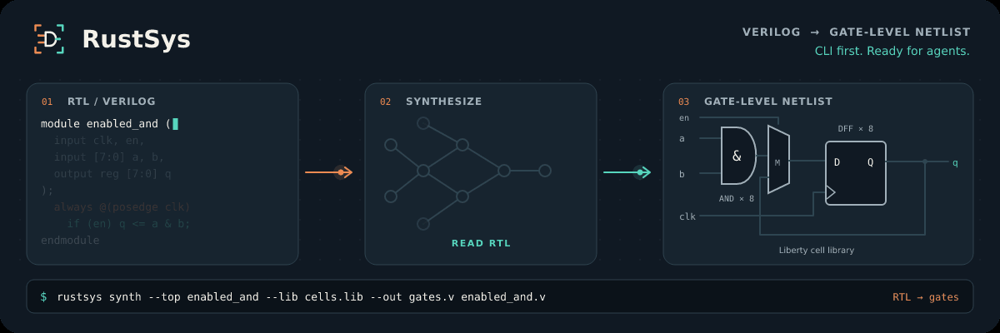

# RustSys

RustSys turns RTL into mapped netlists with bounded synthesis, technology mapping and independently checked equivalence.

[All RustEDA modules](https://lab-emi.github.io/RustEDA/)

<picture>
  <source media="(prefers-reduced-motion: reduce)" srcset="assets/rustsys-banner.svg">
  
</picture>

## RustSys vs Yosys at a glance

Ibex RTL-to-GDS on IHP SG13G2 with EZ130 cells and two SRAM macros, 2026-11-05: RustEDA and LibreLane 3.0.17 (OpenROAD, Yosys, KLayout, Magic, Netgen) ran one after the other on the same 4-vCPU host from the same prepared inputs, and the same signoff scripts checked both layouts.

- **35.4× faster than Yosys + ABC** with LibreLane's synthesis script (3.81 s against 135.04 s, median of three interleaved runs; 44.4× in direct mode), with **6.6× less peak memory**.
- **1.8 % less standard-cell area** (145,226.6 µm² against 147,866.9 µm²) and **logic depth 36 against 40**; the SS critical path arrives at 50.5 ns against 71.7 ns with ideal wires.
- Equivalence of the mapped netlist to the RTL is **proven**; for the Yosys netlist it stays unverified.
- In the full flow, synthesis takes 3.48 s against 132.63 s (**38.1× faster**), and the whole RustEDA flow finishes **4.2× sooner end to end** with a 5.2 % smaller layout.

LibreLane's layout fails the shared timing gate (112 maximum-capacitance and fanout violations at TT and SS) and its equivalence check does not complete, so the receipt keeps its own ratio fields null under its publication rule; the multiples here divide the recorded times. Stages are paired by phase, not as identical tasks. RustEDA is not faster everywhere: its repair before global routing takes 1.18× LibreLane's two pre-route resizer steps alone, OpenRCX runs 1.36× longer on RustEDA's DEF, and the latch-up check 1.11× longer on its layout. [All stages, gates and losses](https://lab-emi.github.io/RustEDA/benchmarks/)

## Development update · 2026-11-05

The RustEDA Ibex host campaign of 2026-11-05 reran the IHP SG13G2 / EZ130
design with two real SRAMs on a 4-vCPU cloud host (a different and slower
machine than on 2026-11-02), with RustSys built from commit [`86e59d8`](https://github.com/lab-emi/RustSys/commit/86e59d816e6ded82333ccc502bb37961c3bb1a9f).
RustSys synthesized the design in the native flow, the flow's synthesis and
final equivalence gates are `proven`, and the native layout passes every shared
gate that gives a pass/fail verdict; the producer completed every step. The run is `unqualified` (the
component-qualification evidence is not published), and LibreLane's layout
fails the timing gate, so the receipt keeps its ratio fields null; divided, the
recorded times give RustEDA a 4.2× shorter end-to-end time.

In the synthesis head-to-head on the same prepared RTL and Liberty, with Yosys +
ABC running LibreLane's synthesis script, **RustSys was faster, used less
memory and produced the smaller and shallower netlist** (three measured runs per
contender on this task and host):

| | RustSys | Yosys 0.70 + ABC, LibreLane script |
| --- | ---: | ---: |
| Median wall, workspace sequence (fastest) | 3.81 s (3.62 s) | 135.04 s (126.82 s) |
| Median wall, direct mode (fastest) | 3.04 s (2.75 s) | — |
| Worst peak RSS, sequence / direct | 116,200 / 115,052 KiB | 766,036 KiB |
| Standard-cell area (`yosys stat -liberty`) | 145,226.592 µm² | 147,866.947 µm² |
| Logic depth in cells, excluding buffers | 36 (36) | 40 (40) |
| Cells: total / sequential / buffer and inverter | 11,433 / 1,998 / 950 | 12,605 / 1,905 / 186 |

Yosys took 35.4× RustSys's median wall time for the workspace sequence and
44.4× for the direct mode. RustSys's netlist has 1.79 % less standard-cell area
than Yosys's and 36 against 40 logic levels; on 2026-11-02 it was 2.18 % larger
and 55 levels deep. RustSys itself is slower than on 2026-11-02 (3.81 s against
2.12 s for the sequence), more than the host change explains (Yosys: 135.04 s
against 102.83 s): its quality changes cost work (the changelog records 29.0 G
instead of 22.0 G instructions for a single-thread Ibex synthesis). The
equivalence verdicts come from the flows' synthesis gates: the native flow's
RustSys netlist is `proven`, and LibreLane's synthesis netlist, the same bytes
as the head-to-head Yosys netlist, is `unverified` (433 registers lack a unique
named RTL counterpart for the checker), which is not evidence of
non-equivalence. The head-to-head RustSys netlist differs in bytes from the
flow's and was not checked separately.

[Synthesis head-to-head](https://lab-emi.github.io/RustEDA/benchmarks/#rustsys-vs-yosys-2026-11-05) ·
[Host campaign evidence](https://lab-emi.github.io/RustEDA/benchmarks/#ibex-host-campaign-2026-11-05)

## Development update · 2026-11-02

The RustEDA Ibex host campaign reran the IHP SG13G2 / EZ130 design with two
real SRAMs on a 4-vCPU cloud host, with RustSys built from commit `0f8a2d8`.
RustSys synthesized the design in the native flow, and the flow's synthesis and
final equivalence gates are `proven`. The native run is `unqualified`, and its
producer stopped at the RustSTA/OpenSTA `timing_accuracy` gate, which does not
involve synthesis; the remaining gates ran separately with the recipe's scripts.

The campaign also includes a RustSys-vs-Yosys head-to-head on the same prepared
RTL and Liberty, with Yosys + ABC running LibreLane's synthesis script. RustSys
had the shorter median wall time and the lower peak memory (three measured runs
per contender on this task and host); the Yosys + ABC netlist has the smaller
standard-cell area and fewer logic levels. The equivalence verdicts come from
the flows' synthesis gates, not from the head-to-head netlists: RustSys's
native-flow netlist is `proven`, and LibreLane's synthesis netlist, the same
bytes as the head-to-head Yosys netlist, is `unverified`, which is not evidence
of non-equivalence. Results, scope and deviations are on the
[RustEDA benchmarks page](https://lab-emi.github.io/RustEDA/benchmarks/).

The 2026-11-01 update preserves opaque SRAM interfaces through elaboration,
mapping and netlist export. Port widths, bus indices and instance/pin identities
are checked; unsupported or inconsistent interfaces produce diagnostics. The
macro's behavior continues to come from its original vendor model for
independent checking.

[Source, evidence and remaining limits](development-status.md) ·
[Synthesis in the benchmark](guide/benchmarks.md) ·
[Synthesis head-to-head](https://lab-emi.github.io/RustEDA/benchmarks/#rustsys-vs-yosys) ·
[Host campaign evidence](https://lab-emi.github.io/RustEDA/benchmarks/#ibex-host-campaign-2026-11-02)


## Development status · 2026-10-28

Superseded by the updates above; kept as the record of that date.
The RustEDA integration combines bounded synthesis, BLIF/AIGER and mapped-netlist
inputs, revision-bound timing optimization and a shared RustEDA foundation.
The earlier Ibex three-library synthesis campaign proves all six RustSys/Yosys
netlists equivalent with arbitrary initial state. Real-SRAM preservation for
IHP Ibex remains experimental; physical closure is a separate open gate.

[Progress, source revisions and verification limits →](development-status.md)

## Benchmark

The published benchmark is the Ibex RV32 core with two real IHP SRAMs on IHP
SG13G2 with the ETH EZ130 8T library, run end to end through the native RustEDA
flow and compared with LibreLane. RustSys synthesizes the Ibex + SRAM design in
that flow; the flow's synthesis and final CEC gates prove the synthesized and
final netlists equivalent to the original RTL.

[RustEDA benchmarks](https://lab-emi.github.io/RustEDA/benchmarks/) ·
[RustSys in the whole-flow benchmark](guide/benchmarks.md)

## A CLI you can compose

<div class="grid cards" markdown>

- **Start with files. Finish with files.**

    ---

    Read RTL and Liberty. Export gate-level Verilog and a JSON report.
    Run in a shell, a CI job, or an agent loop.

    [Synthesis workflow →](guide/synthesis.md)

- **Give agents a contract.**

    ---

    Keep results on standard output and diagnostics on standard error.
    Use structured errors, bounded tables, revision guards, and explicit exit statuses.

    [Agent integration →](guide/agents.md)

- **Keep the evidence.**

    ---

    Record resolved commands, input hashes, events, and reports.
    Check the exported netlist with a separate RTL interpreter and SAT solver.

    [Equivalence workflow →](guide/checking.md)

- **Follow the benchmark.**

    ---

    RustSys synthesizes the Ibex + SRAM design in the RustEDA whole-flow
    benchmark on IHP SG13G2. The flow proves its netlists equivalent to the RTL.

    [Benchmark and proof scope →](guide/benchmarks.md)

</div>

## Choose your path

| I want to… | Start here |
|---|---|
| Install the CLI and try a small checked design | [Installation](guide/installation.md) → [quickstart](guide/quickstart.md) |
| Synthesize my own RTL against a cell library | [Synthesis](guide/synthesis.md) → [language support](reference/language-support.md) |
| Drive the tools from an agent or CI system | [Agent workflow](guide/agents.md) → [commands](reference/cli.md) → [reports](reference/reports.md) |
| Understand what a proof establishes | [Equivalence checking](guide/checking.md) → [verification scope](verification/index.md) |
| Find the published benchmark or assess a performance claim | [Benchmarks](guide/benchmarks.md) |
| Scale CPU synthesis and compare area or setup-Fmax | [CPU performance and scaling](guide/performance.md) |
| Extend RustSys or another RustEDA tool | [Architecture](architecture/index.md) → [contributing](contributing.md) |

## A small first run

From the repository root, after [building RustSys](guide/installation.md):

```bash
FIX=verification/fixtures/synthetic/synth
rustsys synth --top counter --lib "$FIX/lib/wt_rich.lib" \
  --out .work/counter_mapped.v --report .work/counter.json \
  "$FIX/rtl/counter/counter.sv"

rustsys check synth --top counter --lib "$FIX/lib/wt_rich.lib" \
  --netlist .work/counter_mapped.v "$FIX/rtl/counter/counter.sv"
```

The bundled library is a small verification fixture. Use a characterized
technology library for your own standard-cell targets. The
[quickstart](guide/quickstart.md) explains the generated files and verdicts;
the [agent guide](guide/agents.md) adds recorded runs and machine-readable output.

!!! note "Preview status"
    RustSys 0.1.0 is built from source and is not published to crates.io.
    Supported constructs and analysis limits are documented explicitly.
    A synthesis success, a timing estimate, and an equivalence proof are separate results.
