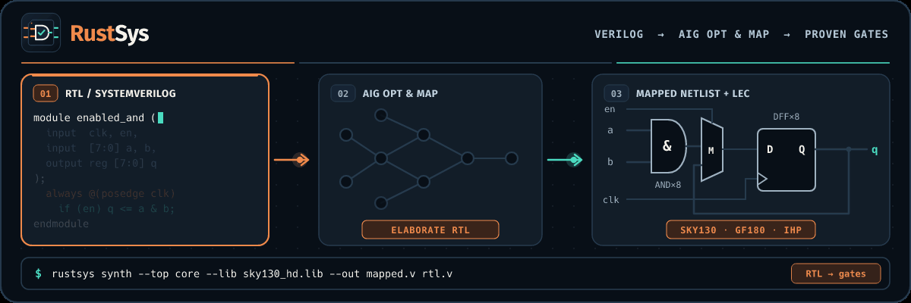

# RustSys

Clean-room RTL synthesis, bounded AIG optimization, technology mapping, and independent formal equivalence checking in Rust.

[All RustEDA modules](https://lab-emi.github.io/RustEDA/) · [Benchmarks](https://lab-emi.github.io/RustEDA/benchmarks/) · [Development status](development-status.md)

<picture>
  <source media="(prefers-reduced-motion: reduce)" srcset="assets/rustsys-banner.svg">
  
</picture>

## Highlights

| Benchmark (receipt-backed) | RustSys | Reference (`Yosys + ABC`) | Delta |
| --- | ---: | ---: | --- |
| **Ibex + 2 SRAMs** (IHP SG13G2 / EZ130, 3-run median) | **3.07 s** (2.19 s direct) | 103.91 s | **33.8× faster** (47.4× direct) |
| **Peak memory** (same Ibex synthesis) | **113.5 MiB** | 747.7 MiB | **6.6× less RAM** |
| **Post-synth QoR** (area / logic depth) | **145,227 µm² / 36** | 147,867 µm² / 40 | **-1.8% area, -4 levels** |
| **Non-Ibex cores** (`picorv32`, `aes_core`, `sha256_core`) | **8/8 signoff PASS** | LibreLane 3.0.17 | **+18.7% to +70.4% SS Fmax** |
| **Formal LEC** (arbitrary-init + reset-reachable FSM map) | **ABC CEC proven** | Unverified | **Proved** |

## Guides & Reference

- **Get started**: [Installation](guide/installation.md) · [Quickstart](guide/quickstart.md) · [Synthesis](guide/synthesis.md) · [AI Agents](guide/agents.md)
- **Verification**: [Equivalence checking](guide/checking.md) · [Dual-PDK testing](verification/pdk.md) · [Requirements](verification/requirements.md)
- **Reference**: [CLI](reference/cli.md) · [Language support](reference/language-support.md) · [Reports](reference/reports.md) · [Architecture](architecture/index.md)

## Known Limits

- `rustsys synth --timing-period` and `opt-timing` currently reject opaque macro buses.
- Exhausted equivalence budgets always report `unverified`, never a pass.
- Historical campaign receipts and the withdrawn full-SoC PULPissimo measurements are archived under [Development status](development-status.md) and [RustEDA Benchmarks](https://lab-emi.github.io/RustEDA/benchmarks/).
